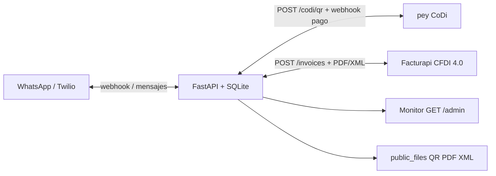

# Cobro WhatsApp + CoDi (pey) + CFDI 4.0 (Facturapi)

MVP para hackathon: el comercio cobra por WhatsApp con **QR CoDi** (sin comisión de tarjeta) y, si el cliente lo pide, **timbra automáticamente un CFDI 4.0** sin salir del chat.

## Problema y propuesta de valor

Cobrar con tarjeta implica ~3.5% de comisión y facturar después es un proceso aparte (portal, PDF, XML, datos fiscales). Este MVP une ambos flujos:

- **Cobro instantáneo** vía CoDi (`pey`) desde WhatsApp (Twilio).
- **Facturación CFDI 4.0** vía Facturapi cuando hay pago **y** datos fiscales válidos.
- **Consola de Tesorería** en `/admin` (UI ejecutiva CoDi + CFDI 4.0) para proyectar KPIs en la demo.

## Arquitectura



| Componente | Rol |
|---|---|
| Twilio WhatsApp | Canal del comercio y del cliente |
| FastAPI + SQLite | Orquestación, máquina de estados, idempotencia |
| pey | Generación de QR CoDi y notificación de pago |
| Facturapi | Timbrado CFDI 4.0 y descarga PDF/XML |
| `/admin` | Consola de Tesorería en tiempo real (polling ~2.5s) |

## Máquina de estados paralela

El cobro y la captura fiscal avanzan **en paralelo**. El timbrado (`evaluar_y_timbrar`) solo dispara cuando se cumplen **ambas** condiciones:

1. `pago_estado == 'PAGADO'`
2. `datos_fiscales_ok == 1`
3. `facturapi_id IS NULL` (idempotencia)

No importa si llegó primero el webhook de `pey` o los datos fiscales por WhatsApp.

```
Productos → ¿Factura? (1/2) → QR CoDi
                ├─ Sí → datos fiscales (o reutilizar clientes_fiscales)
                └─ No → solo espera pago
Pago pey ─┬─ + datos OK → timbrar Facturapi → PDF/XML por WhatsApp
          └─ sin datos → espera; al llegar datos → timbrar
```

### Tolerancia a fallos

| Escenario | Comportamiento |
|---|---|
| Webhook `pey` duplicado (mismo `transactionId`) | `200 OK`, sin re-notificar ni re-timbrar |
| `POST /codi/qr` timeout / 5xx | `200` a Twilio + aviso al usuario para reintentar |
| Facturapi 4xx/5xx (RFC/CP inválido) | Mantiene `PAGADO`, `ERROR_FISCAL` + `error_fiscal`, pide corrección **sin volver a cobrar** |
| PDF/XML vacío o no-200 | No guarda archivos de 0 bytes ni marca `COMPLETADO` |
| `numRef` desconocido | `200 OK` e ignora el evento |

## Instalación rápida

```bash
python3 -m venv .venv
source .venv/bin/activate   # Windows: .venv\Scripts\activate
pip install -r requirements.txt
cp .env.example .env        # edita con tus llaves reales
```

### Variables de entorno (`.env`)

| Variable | Descripción |
|---|---|
| `PEY_API_KEY` | API key de [portal.mipey.mx](https://portal.mipey.mx) |
| `TWILIO_ACCOUNT_SID` / `TWILIO_AUTH_TOKEN` | Credenciales Twilio |
| `TWILIO_WHATSAPP_FROM` | Ej. `whatsapp:+14155238886` (Sandbox) |
| `FACTURAPI_KEY` | Sandbox o live de [facturapi.io](https://www.facturapi.io) |
| `PUBLIC_URL` | URL pública del túnel (sin slash final) |

## Ejecución

```bash
uvicorn main:app --host 0.0.0.0 --port 8765 --reload
```

Expón el puerto con Cloudflare Tunnel:

```bash
cloudflared tunnel --url http://localhost:8765
```

Copia la URL HTTPS resultante a `PUBLIC_URL` en `.env` y reinicia uvicorn.

### Webhooks (URLs exactas)

| Proveedor | Método | Path |
|---|---|---|
| **Twilio Sandbox** | `POST` | `{PUBLIC_URL}/whatsapp/webhook` |
| **portal.mipey.mx** | `POST` | `{PUBLIC_URL}/pey/webhook` |

También disponibles:

- `GET /admin` — monitor visual
- `GET /api/ordenes` — JSON de KPIs + órdenes
- `POST /api/ordenes/{id}/reintentar-timbrado` — reintento manual
- `GET /files/...` — QR, PDF y XML generados

## Demo en vivo con $0.01 MXN

1. Abre `/admin` en pantalla grande (proyector).
2. Desde el WhatsApp Sandbox de Twilio, envía al bot:
   ```
   1 Prueba CoDi 0.01
   ```
3. Responde `1` si quieres factura (o `2` solo cobro).
4. Escanea el QR CoDi y paga **$0.01 MXN**.
5. Si pediste factura, envía datos fiscales de prueba del SAT (Sandbox Facturapi), por ejemplo:
   ```
   XAXX010101000 | PUBLICO EN GENERAL | 06600 | 616 | G03
   ```
6. En `/admin` verás el badge **PAGADO**, luego **TIMBRADO** con enlaces PDF/XML.
7. Si Facturapi rechaza datos, corrige el mensaje o usa **Reintentar timbrado** — el cobro no se repite.

## Pruebas

Suite de fallos (idempotencia, carreras, timeouts, rechazo fiscal, malformados, PDF vacío, KPIs):

```bash
pytest -v
```

## Flujo de chat (resumen)

1. Comercio envía productos (uno por línea): `2 Cafe 45`
2. Bot calcula total con `Decimal` y pregunta factura (`1` / `2`)
3. Genera QR CoDi (`expiration: 600`, `numRef = orden_id`) y lo manda por WhatsApp
4. Pago y/o datos fiscales llegan en cualquier orden → `evaluar_y_timbrar`
5. PDF + XML se validan (`200` y `len(content) > 0`) antes de guardarse en `public_files/`

## Licencia

Proyecto de hackathon — uso demo / educativo.
